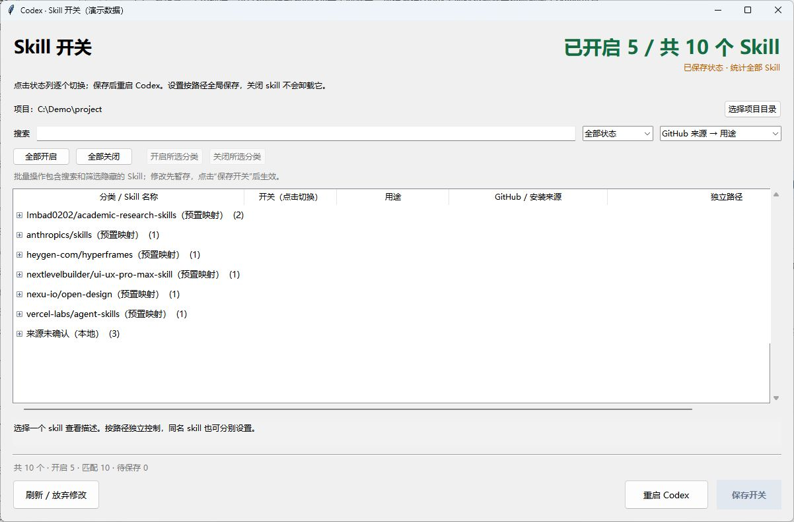
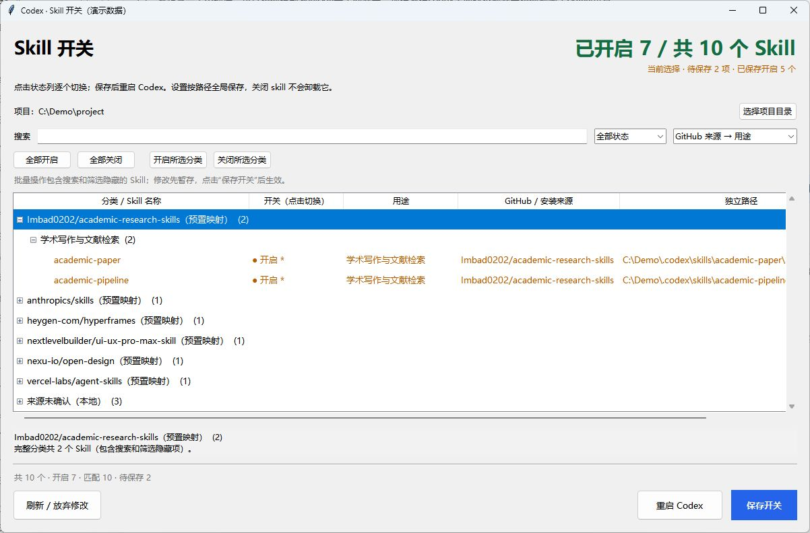

# Codex Skill 开关

用于 Windows 的本地独立小窗口，按完整路径管理 Codex 的单个 Skill 开关。

## 功能

- 单独开启或关闭 Skill，同名 Skill 也能分别控制。
- 顶部显示开启数量、总数和待保存数量。
- 按 GitHub 来源及用途分组，可切换分组顺序，目录默认折叠。
- 支持全部开启、全部关闭，以及所选来源或用途分类的批量开关。
- 搜索名称、描述、用途、来源或路径，支持按状态筛选。
- 修改先暂存，保存前备份配置，保存后重新读取核对有效状态。
- 检测外部配置变化，避免覆盖其他程序刚修改的配置。
- 提供重启 Codex 按钮。

## 界面预览

以下为真实程序界面，使用演示 Skill 和示例路径；实际数量及分类取决于本机安装情况。

**主界面：** 顶部显示开启数量，来源目录默认折叠，可搜索、筛选或切换分组方式。



**分类批量开关：** 选中来源或用途分类后可批量切换。橙色标记和蓝色“保存开关”按钮表示有待保存修改。



## 启动

推荐下载 [Releases](https://github.com/cerealV/codex-skill-switcher/releases) 中的 `CodexSkillSwitcher-1.0.1-x64-setup.exe`。安装后从开始菜单打开 **Codex Skill Switcher**；安装程序自带 Python / Tk，不需要另外安装 Python。支持 Windows 10/11 x64，仍需先安装并运行过 Codex 桌面版。安装仅面向当前用户，无需管理员权限，卸载不会删除 Codex 配置和 Skill。

从源码启动：

1. 在仓库页面点击 **Code → Download ZIP**，解压全部文件。
2. 确保已安装并运行过 Windows Codex 桌面版。
3. 双击 `skill-switcher/Start-Skill-Switcher.cmd`。

启动器使用当前用户目录下 Codex 自带的 Python / Tk 运行环境。需要 Python 3.12 或更高版本；没有额外第三方 Python 依赖。如果运行环境位置不同，可以自行执行 `python skill-switcher/skill_switcher.py`，并确保 Python 包含 Tk。

程序优先查找 Codex 桌面版附带的 App Server，其次查找标准 npm 安装的 Windows x64 Codex CLI。若未来版本更改安装路径，需相应更新 `find_codex()`。内置重启按钮面向通过 Windows 应用包安装的 Codex 桌面版。

## 使用

1. 按需选择项目目录，查看该项目可发现的 Skill。
2. 点击 Skill 的开关列，或选中 Skill 后按空格。
3. 批量操作时，点击“全部开启 / 全部关闭”；也可先选中分类行，再点击“开启所选分类 / 关闭所选分类”。折叠目录同样可操作。
4. 点击蓝色的“保存开关”，等待重新读取并核对状态。
5. 点击“重启 Codex”重新加载。重启会中断正在运行的任务，按钮会先提示。

顶部数量统计当前项目返回的完整 Skill 列表。批量操作包含被搜索或状态筛选隐藏的成员。搜索时临时展开匹配目录，清空搜索后恢复之前的展开状态。

“刷新 / 放弃修改”可丢弃尚未保存的选择。没有待保存修改时，保存按钮为灰色。

## 来源与分类

本工具读取本机 `.agents/.skill-lock.json` 和 Skill 的 `references/source.json` 等来源记录。插件、系统内置 Skill 分别显示其真实标识。

`catalog.json` 包含用途分类和预置的公开仓库映射。**预置映射不是本机实际下载来源的证明**，界面会单独标为“预置映射”；本机安装记录优先。无法确认的来源保留为“来源未确认”。仓库只包含映射信息，不包含这些第三方 Skill 的代码或安装历史。

## 配置与恢复

通过本机 Codex App Server 的 `skills/list` 和 `skills/config/write` 接口操作，不调用模型，不需要 API Key。

开关按 Skill 的完整路径写入用户级配置。项目级设置可能覆盖用户设置；保存后发现有效状态与选择不同会报告错误。关闭 Skill 不会删除目录或卸载插件，也不会关闭插件的 MCP 工具。整个插件被禁用时，其 Skill 可能不出现在列表中。

配置备份保存在实际 Codex 配置目录，文件名类似 `config.toml.skill-switcher-日期时间.bak`。如需恢复，先关闭 Codex 与本工具，再将所需备份覆盖同目录的 `config.toml`。不要上传配置文件或备份。

## 验证

在安装了兼容 Codex App Server 的 Windows 环境中运行：

```powershell
python tests/test_skill_switcher.py
```

10 项测试覆盖开关暂存、路径隔离、配置保护、分类批量范围、安装版默认项目目录及底部按钮布局。布局检查在 Tk 模拟的 100%、150%、200% 缩放下测试默认和最小窗口尺寸。写入测试使用临时项目和临时配置。

重启脚本已测试应用定位与 DryRun；尚未自动验证真实退出并重开的完整流程。

## 构建 Windows 安装包

需要 Windows x64、Python 3.12（包含 Tk）、PyInstaller 6.22.3 和 [Inno Setup 6](https://jrsoftware.org/isinfo.php)。建议在独立虚拟环境中安装构建依赖：

```powershell
python -m venv .venv
.venv\Scripts\python.exe -m pip install PyInstaller==6.22.3
.\packaging\build.ps1 -Python .venv\Scripts\python.exe -Iscc 'C:\Program Files (x86)\Inno Setup 6\ISCC.exe'
```

产物位于 `dist/CodexSkillSwitcher-1.0.1-x64-setup.exe`，校验值位于 `dist/SHA256SUMS.txt`。安装包包含程序及 Python/Tk 运行时，不包含本机的 Codex 配置、Skill、账号或登录凭据。

## 参考

- [Codex Skill 启停说明](https://learn.chatgpt.com/docs/build-skills#enable-or-disable-local-codex-skills)
- [Codex App Server](https://learn.chatgpt.com/docs/app-server)

这是个人工具项目，与 OpenAI 无隶属关系。
